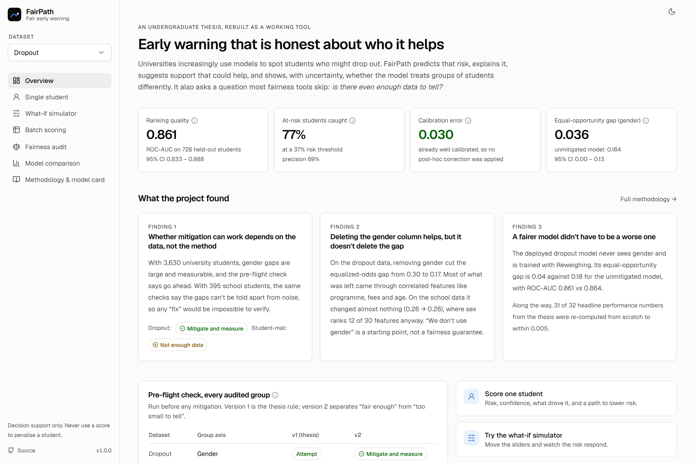
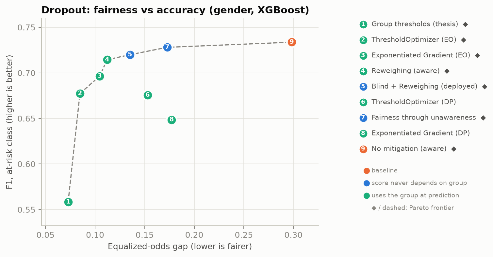
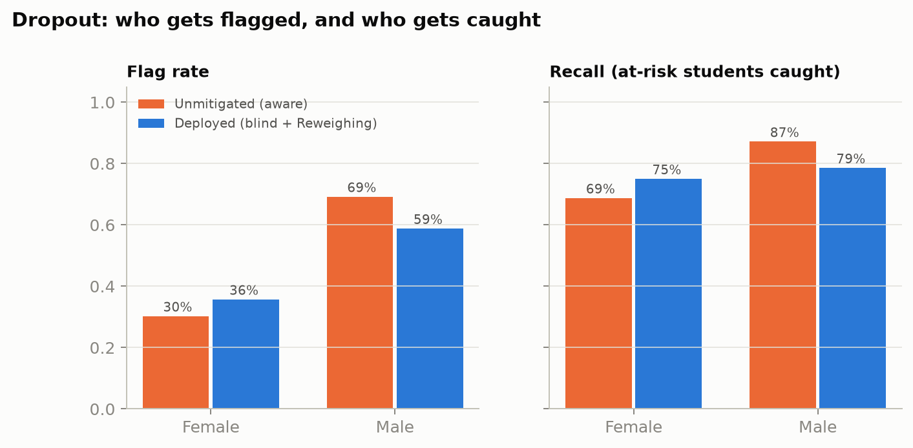
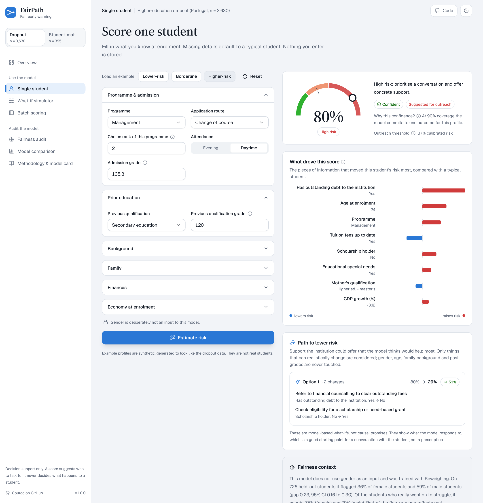
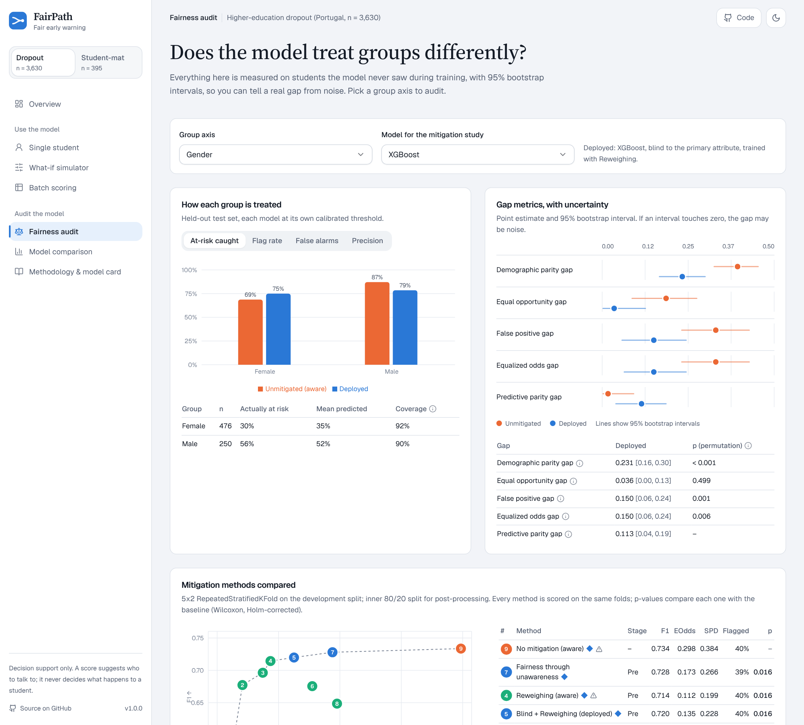
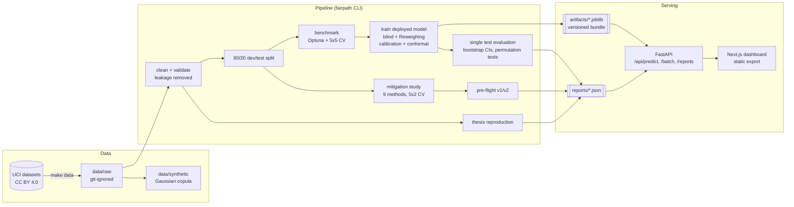

<div align="center">

# FairPath

**Fairness-aware early warning for student success: predict who might need support, explain why, and check honestly whether the model treats groups of students differently.**

[](https://github.com/SadrulCrafts/fairpath/actions/workflows/ci.yml)


[](https://<your-demo-url>)

[**Live demo**](https://<your-demo-url>) · [Results](docs/RESULTS.md) · [Model card](MODEL_CARD.md) · [Datasheet](DATASHEET.md) · [Reproducibility & thesis errata](docs/REPRODUCIBILITY.md)



</div>

---

## In two minutes

Universities use models to flag students who might drop out, so that an advisor can reach out early. Those models are
usually judged on overall accuracy, which says nothing about *who* they miss. If a model catches 87% of struggling men
but only 69% of struggling women, the women get less help, and the accuracy number hides it.

This project started as my undergraduate thesis at Gannan Normal University, *"Investigating Algorithmic Bias in Student
Success Prediction Models: A Comparative Study"*. Most fairness work asks *which* mitigation method works best. I asked the
question that comes first: **under what conditions of data size and signal strength can mitigation work at all?**

FairPath turns that research into a tool:

* a **leak-free, reproducible pipeline** (5 model families, Optuna tuning, 5x5 CV, a held-out test set used once);
* a **fairness audit with uncertainty**: every gap gets a bootstrap interval and a permutation test, and small groups are flagged;
* **bias mitigation at all three stages** (pre-, in- and post-processing) compared inside one CV loop, with a Pareto frontier;
* a **pre-flight check** that tells you, before you start, whether a fairness fix could even be measured on your data;
* a **dashboard** where an advisor can score a student and see a calibrated risk, an honest confidence level, what drove the
  score, which *support* could lower it, and how the model behaves across groups.

## What I found

All numbers are from the real UCI data and are regenerated by `make train`. Full tables: [docs/RESULTS.md](docs/RESULTS.md).

| | Dropout (university, n = 3,630) | Student-mat (secondary school, n = 395) |
|---|---|---|
| Deployed model | XGBoost, gender-blind, trained with Reweighing | Logistic regression, sex-blind, Reweighing |
| Test ROC-AUC [95% CI] | **0.861** [0.833, 0.888] | 0.665 [0.546, 0.780] |
| At-risk students caught (recall) | 0.768 at a 0.37 risk threshold | 0.577 at 0.30 |
| Calibration error (ECE) | 0.030 | 0.077 |
| Conformal coverage (target 0.90) | 0.912 | 0.924 |
| Equal-opportunity gap: deployed vs unmitigated | **0.036** vs 0.184 | 0.418 vs 0.327, with overlapping CIs ([0.10, 0.73] vs [0.04, 0.67]) |
| Equalized-odds gap: deployed vs unmitigated | **0.150** vs 0.328 | 0.418 vs 0.327 |
| Pre-flight check (v2), primary axis | Mitigate and measure | Insufficient data |

**1. Whether mitigation can work depends on the data, not the method.** On the dropout data every mitigation family
reduced the equalized-odds gap significantly (Wilcoxon, Holm-corrected). On the school data nothing did, apart from
degenerate solutions that flag everyone or no one (point 4). The gaps sit at the level a
random predictor produces (model |SPD| / dummy |SPD| = 0.93), and the test-set intervals are so wide that the "deployed vs
unmitigated" comparison above can't be read as better or worse. That's exactly what the pre-flight check predicts.

**2. Deleting the gender column helps, but it doesn't delete the gap.** On the dropout data, removing gender cut the
equalized-odds gap from 0.30 to 0.17 in cross-validation. Most of what was left came through correlated features like
programme, tuition status and age. Adding Reweighing brought it to 0.14. On the school data, removing sex changed nothing (0.26 → 0.26).

**3. A fairer model didn't have to be much worse.** The deployed dropout model halves the equalized-odds gap (0.328 → 0.150)
for a test ROC-AUC of 0.861 against 0.864, and the gap in *catching* at-risk students drops from 0.18 to 0.04.

**4. Some "fair" solutions are fake.** On the small dataset, the thesis' group-threshold search and Exponentiated Gradient reached
a gap of zero by flagging *everyone* or *no one*. FairPath detects these degenerate solutions and keeps them off the frontier.

**5. The thesis holds up.** The original code was lost, so I rebuilt everything from the thesis text and re-ran the original
protocol as a check: **31 of 32** values in the main performance table and both noise floors came back within 0.005. While doing it
I found and documented 12 errors in the thesis write-up ([docs/REPRODUCIBILITY.md](docs/REPRODUCIBILITY.md)), and a weakness in my own
pre-flight rule, which version 2 fixes.

<p align="center">
  
  
</p>

## Quickstart

```bash
git clone https://github.com/SadrulCrafts/fairpath.git && cd fairpath
make setup                       # Python deps + editable install (Python 3.11+)
make run                         # builds the dashboard and serves everything at http://localhost:8000
```

The repository ships trained models and reports, so `make run` works straight away. To rebuild everything yourself:

```bash
make data          # download both UCI datasets (not committed to git)
make train         # full pipeline on the real data, ~25 min on 2 CPU cores
make train-fast    # or: the same pipeline on the bundled synthetic data, a few minutes
make test          # 47 fast tests (make test-all adds the end-to-end run)
```

Or with Docker: `docker compose up --build`, then open <http://localhost:7860>.
Free hosting options (Vercel for the dashboard + Render for the API, or a single Render service) are in [docs/DEPLOYMENT.md](docs/DEPLOYMENT.md).

**Use just the pre-flight check on your own predictions:**

```bash
fairpath preflight my_predictions.csv --label dropped_out --group gender --score risk
```

## The dashboard

| Page | What it's for |
|---|---|
| **Overview** | The project in one screen: key results, findings, pre-flight verdicts for every audited group |
| **Single student** | Risk, risk band, conformal confidence, SHAP drivers, a *path to lower risk* built only from changeable support, and the model's fairness record |
| **What-if simulator** | Move the levers an institution can influence (tuition support, scholarships, tutoring, study time) and watch the score respond |
| **Batch scoring** | Upload a CSV, schema-checked before scoring; download results as CSV or a PDF summary |
| **Fairness audit** | Per-group rates, gap metrics with intervals and p-values, all nine mitigation methods on a Pareto chart, a live threshold explorer, the pre-flight check |
| **Model comparison** | Five tuned families with corrected intervals and significance tests, calibration curves, tuned hyper-parameters |
| **Methodology & model card** | The research, pipeline, intended use and limits, datasheet, and the thesis reproduction table |

<p align="center">
  
  
</p>

Every metric has a plain-language tooltip. Light and dark mode, keyboard accessible, and it works on a phone. Nothing a user types or
uploads is stored.

## Architecture



* **Python**: scikit-learn pipelines, XGBoost, LightGBM, Optuna, Fairlearn, SHAP, pandas, FastAPI, Pydantic.
* **Web**: Next.js 15 (static export), React 19, Tailwind CSS, Radix UI primitives in the shadcn/ui style, Recharts.
* **Ops**: one Docker image (Node build stage + slim Python runtime), GitHub Actions (lint, tests, smoke pipeline, web build, Docker build), pre-commit.
  The audit pages read static JSON bundled with the dashboard, so they open instantly even when a free API host is asleep; only live predictions need the API.

## Repository layout

```
fairpath/
├── configs/                 # default.yaml (experiment), datasets/*.yaml (cleaning, sensitive attrs, feature labels)
├── src/fairpath/
│   ├── data/                # loading, cleaning, schema validation, synthetic data, download
│   ├── evaluation/          # metrics, bootstrap CIs, calibration, corrected statistical tests
│   ├── fairness/            # group metrics, permutation tests, pre-flight check v1/v2
│   ├── explain/             # SHAP, actionable counterfactuals, conformal prediction
│   ├── mitigation.py        # Reweighing, Exponentiated Gradient, group thresholds, ThresholdOptimizer
│   ├── pipeline/            # thesis_repro, benchmark, fairness_study, train, reporting, figures
│   ├── api/                 # FastAPI app, schemas, PDF report
│   ├── inference.py         # versioned model bundle + predictor
│   └── cli.py               # `fairpath ...`
├── web/                     # Next.js dashboard
├── artifacts/               # trained bundles + registry.json (SHA-256, data fingerprint, git commit)
├── reports/                 # every number shown anywhere, as JSON
├── notebooks/               # 01 EDA · 02 thesis reproduction · 03 fairness audit
├── docs/                    # RESULTS, REPRODUCIBILITY, ARCHITECTURE, FAIRNESS_GUIDE, API, DEPLOYMENT, academic/
├── tests/                   # unit, API and end-to-end tests (synthetic data only)
├── MODEL_CARD.md · DATASHEET.md · CITATION.cff · CHANGELOG.md · CONTRIBUTING.md
└── Dockerfile · docker-compose.yml · Makefile · pyproject.toml
```

## Methodology in brief

* **No leakage.** Dropout: students still enrolled at the cut-off are removed (their outcome is unknown), and the 12
  end-of-semester columns are dropped (they push AUC to 0.95 in the EDA notebook). Student-mat: in-year grades G1/G2 dropped.
  All preprocessing is fitted inside each fold.
* **Honest evaluation.** One stratified 80/20 split; tuning, model selection, calibration and threshold choice happen only on the 80%.
  Model comparisons use the Nadeau–Bengio corrected t-test. A naive Wilcoxon over the same 25 folds calls LR "significantly worse"
  than XGBoost (p < 0.001); the corrected test says p = 0.35.
* **Fairness with uncertainty.** Max-minus-min gaps for demographic parity, equal opportunity, false-positive rate, equalized odds,
  predictive parity and calibration; stratified bootstrap CIs (1,000 resamples) and permutation tests (2,000 permutations).
* **Deployment choice.** The deployed model never takes the sensitive attribute as input and uses Reweighing, which only needs it
  at training time. Methods that use the group at prediction time can close gaps further; the dashboard shows them but doesn't ship
  them, because then two students with the same record could be scored differently because of their group.
* **Explanations.** TreeSHAP or linear SHAP, summed back from one-hot columns to the original features (exact, by additivity).
  Counterfactuals only search features marked as realistically changeable and never touch protected attributes.
* **Uncertainty.** Split-conformal prediction sets at 90% coverage turn a probability into "confident" or "uncertain".

More in [docs/ARCHITECTURE.md](docs/ARCHITECTURE.md) and [docs/FAIRNESS_GUIDE.md](docs/FAIRNESS_GUIDE.md).

## Data

Both datasets are public under CC BY 4.0. They are **not** redistributed here; `make data` downloads them from UCI. A synthetic copy
with the same columns (no real row copied) is committed so that the code runs out of the box. All reported results come from
the real data. See [DATASHEET.md](DATASHEET.md).

* V. Realinho, J. Machado, L. Baptista and M. V. Martins, "Predicting Student Dropout and Academic Success," *Data*, 7(11):146, 2022.
* P. Cortez and A. M. G. Silva, "Using data mining to predict secondary school student performance," *Proc. FUBUTEC*, 2008.

## Limitations

Two Portuguese datasets, binary gender, binary outcomes, labels that reflect past institutional practice, and an offline evaluation
with no field deployment. Debtor and tuition status may be recorded after enrolment; without them the dropout model's AUC falls from
0.85 to 0.80. The school dataset is too small for any firm group-level claim, and the tool says so. Read the [model card](MODEL_CARD.md)
before using any score. **This is decision support. It must never be used to penalise, exclude or label a student.**

## Where this could go next

Fairness under distribution shift between cohorts; causal analysis of the proxy pathways; Bayesian group-rate estimates for very small
groups; how students themselves understand these explanations; privacy-preserving training across institutions; and a multi-country
replication of the pre-flight check. Details in [docs/academic/research_directions.md](docs/academic/research_directions.md).

## Citation

```bibtex
@software{anam_fairpath_2026,
  author  = {Anam, MD Sadrul},
  title   = {FairPath: Fairness-aware early warning for student success},
  year    = {2026},
  version = {1.0.0},
  url     = {https://github.com/SadrulCrafts/fairpath}
}
```

## Author

**MD SADRUL ANAM**, Gannan Normal University. Interested in algorithmic fairness, responsible AI and AI in education.
<br>Email: `<your-email>` · LinkedIn: `<your-linkedin>`

Code is MIT-licensed. If you work on fairness in education and something here is useful, or wrong, I'd like to hear about it.
